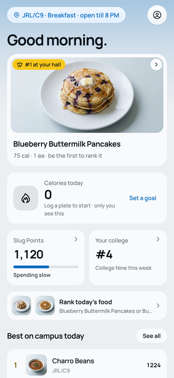
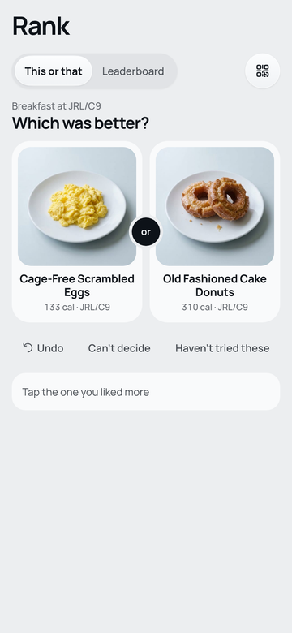
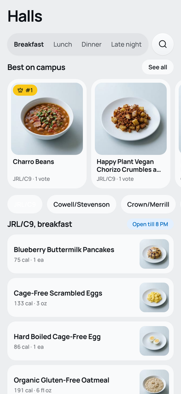
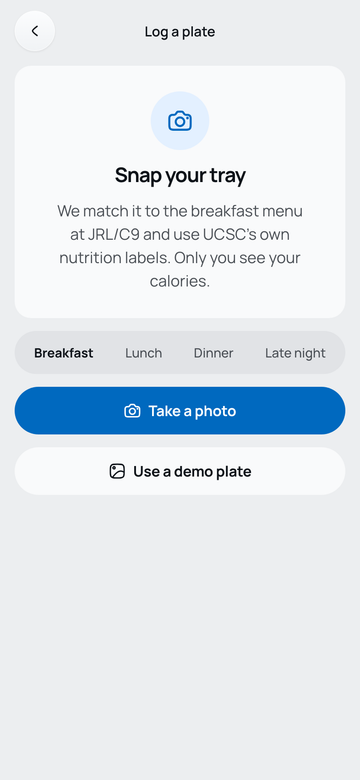
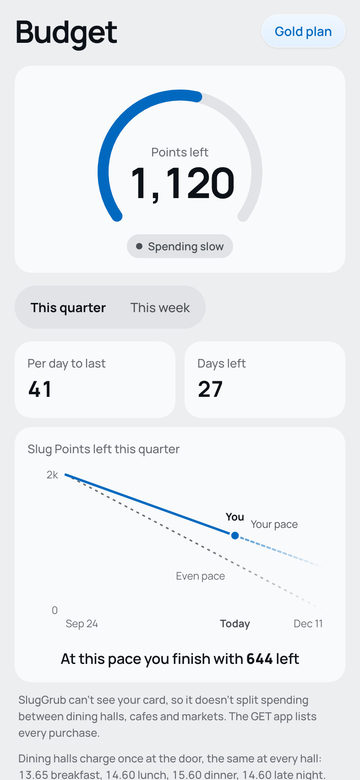

# SlugGrub

**UCSC dining, ranked by students.** Rank dining hall food with this-or-that votes, track calories and protein by snapping your tray, and see if your Slug Points will last the quarter. Built at DevFest 2026.

**Try it: [sluggrub.vercel.app](https://sluggrub.vercel.app)** (made for phones; on a laptop it shows in a phone-width column)

<p>
  
  
  
  
  
</p>

## What it does

- **Rank.** Pick between two dishes on today's menu. The picks build a live leaderboard for every dining hall and a weekly rivalry between the ten colleges.
- **Live vote.** A projector shows two dishes and a QR code (`/vote/screen`); anyone can scan it and vote from their phone, and the tally updates as they do.
- **Log a plate.** Take a photo of your tray. Gemini matches it to that hall's real menu and estimates the servings, so calories and protein come from UCSC's own nutrition labels. An optional goal from onboarding fills a ring on Today. Calories stay on your phone.
- **Slug Points.** Logging charges one dining hall entry per visit at UCSC's door prices (plates at the same hall within two hours are one visit). Budget shows your pace and when you'd run out.
- **Ask SlugGrub.** Ask for something like "high protein under 700 cal" and it picks from what the halls are serving right now, streaming each step as it works.
- **Halls.** Every hall's menu, hours and open status for today, plus the cafes and markets, all live from UCSC Dining.
- **Dining services view.** The same votes show which dishes students love and which they pass on (`/dining-services`).

## How it works

- **Next.js 16 and React 19** web app on **Vercel**, so anyone can open it from a link or a QR code with nothing to install.
- **Live menus.** The server reads menus, hours and nutrition labels from [nutrition.sa.ucsc.edu](https://nutrition.sa.ucsc.edu/) and [dining.ucsc.edu](https://dining.ucsc.edu/), and keeps saved copies in `data/` as a fallback.
- **Gemini** (`@google/genai`, server routes only) reads tray photos (`/api/log`) and answers Ask SlugGrub (`/api/ask`). Every dish it returns is checked against the real menu before it shows.
- **Dish photos.** The menu site has no pictures, so every dish photo in `public/food/gen/` was made with Gemini's image model (`scripts/food-images.mjs`, prompt in `docs/food-image-prompt.md`).
- **Firebase.** Firestore holds the votes, rankings and live round, with anonymous sign-in and security rules that allow one vote per phone per matchup (`firestore.rules`).
- **Design system.** One written system for color, type, spacing and motion in `docs/DESIGN.md`, with every choice logged in `docs/DECISIONS.md`.

## Run it locally

```bash
npm install
cp .env.example .env.local   # add a Gemini API key and the Firebase web config
npm run dev                  # http://localhost:3000
```

For phone testing, use the production build: `npm run build`, then `npx next start -p 3001 -H 0.0.0.0`, and open `http://<your-laptop-ip>:3001` on the same wifi.

## Project layout

```
src/app/            pages: / (Today), /rank, /halls, /budget, /log, /ask, /onboarding, /settings, /vote, /dining-services
src/app/api/        server routes; Gemini runs here only (/api/log, /api/ask)
src/components/     screens and shared UI
src/lib/            menus, hours, rankings, budget math, profile
data/               saved menus and nutrition labels
scripts/            menu fetchers and the dish photo generator
docs/               design system, decisions, demo run sheet
```

## Team

Arshawn (design, Today, photo log), Karen (rankings, Firebase, live vote, dining services view) and Ethan (menus, Halls, Budget, onboarding, Ask SlugGrub).

## Earlier work

The menu-matched photo logging idea comes from Trackify, a calorie tracking app Arshawn made before the event. The Ask screen's step-by-step status line and text pacing come from Chalk, another app he made. Everything else was built at DevFest 2026.
